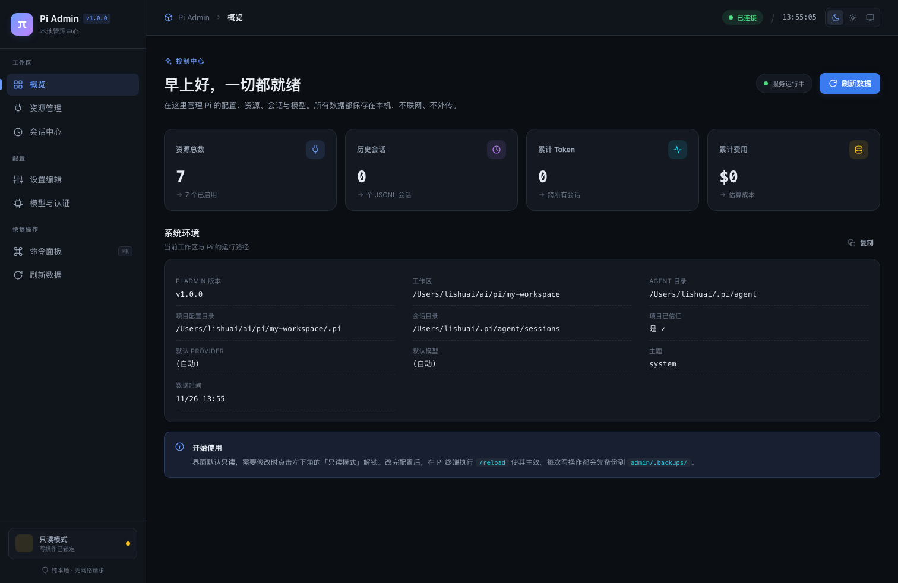
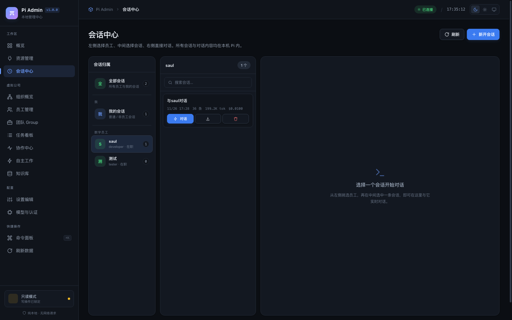

# Pi Wake — 基于 Pi 的本地数字员工工作台

> 本项目是 [Pi Coding Agent](https://pi.dev) 的本地二次开发版本。**上游 Pi 源码保持不变**，所有定制内容都集中在 `my-workspace/`，这样上游更新时可以直接重新导入并合并定制层。

Pi 本身是一个极简、可扩展的编码 Agent：支持交互式终端、RPC 模式、JSON 模式和 TypeScript SDK，可用扩展、技能、提示词模板和主题深度定制。本仓库在它之上做了一套**纯本地的 Web 管理端 + 数字员工组织体系**，把模型、配置、会话、团队和费用统一管起来。

## 核心能力

| 能力 | 说明 |
|---|---|
| **本地 Web 管理端** | 零新增依赖，Node 原生 HTTP 服务，只监听 `127.0.0.1:8787`；图形化管理资源、模型、设置、会话和组织，不用改 Pi 源码 |
| **数字员工组织** | 部门 / 团队 / 员工三级结构，支持岗位、模型、技能、权限与预算配置；技能按「部门 → 团队 → 员工」继承并去重 |
| **会话中心** | 三栏联动：左侧归属（员工 / 协作群 / 我的会话）、中间会话列表、右侧实时对话；群聊直接挂在会话中心，支持 @ 唤醒任意员工 |
| **群聊与群 SOP** | 可视化定义协作流程，多个 SOP 可并行；内置 QoderWake 工程研发、缺陷修复、交付前验证等模板 |
| **用量与费用统计** | 基于模型真实 `usage`，不按文本估算；概览有每日用量多折线图（Token / 费用双轴、按模型分线、悬浮明细），员工累计用量可重置 |
| **人民币计价** | 国内模型原生人民币；DeepSeek 区分工作日高峰 / 空闲时段；海外模型按真实账单或模型单价折算人民币 |
| **技能与规范** | 内置 Velocity/SQL 优化规范、技能库管理、SOP 模板管理；可从 QoderWake 导出目录批量导入技能与工作流 |
| **管家与命令面板** | 浮动管家可问答配置、代劳导入；`⌘K` / `Ctrl+K` 全局搜索页面和操作 |

## 快速开始

### 1. 启动管理端

推荐双击 `my-workspace/admin/启动管理端.command`（普通终端启动，能避开沙箱对 Pi 锁文件的拦截）。

也可以手动启动：

```bash
cd my-workspace/admin
bash start.sh              # 默认 8787 端口
```

浏览器打开 **http://127.0.0.1:8787**。停止服务在终端按 `Ctrl+C`。

> 需要 Node.js 22.19 或更高版本。管理端自身无第三方依赖；Pi 子进程通过一个隔离运行时目录同步配置，不会触碰 `~/.pi/agent/*.lock`。

### 2. 在定制工作区里使用 Pi

```bash
cd my-workspace
pi
```

进入后可用：

```bash
/skills                 # 查看可用技能
/skill:velocity-sql     # 强制加载 Velocity/SQL 规范
/sqlreview              # 示例扩展：打印 SQL 检查规则
/reload                 # 修改技能或扩展后热重载
```

## 界面预览

| 概览与用量 | 会话中心 | 组织与员工 |
|---|---|---|
|  |  |  |

完整功能说明见 **[管理端手册](my-workspace/admin/README.md)**，调研资料见 **[文档索引](my-workspace/docs/README.md)**。

## 目录结构

```text
.
├── my-workspace/                  # 本仓库的全部定制内容
│   ├── AGENTS.md                  # 项目级代码规范（Pi 启动时自动加载）
│   ├── admin/                     # 本地 Web 管理端（零新增依赖）
│   │   ├── server.mjs             # Node 原生 HTTP 后端 + Pi RPC 管理
│   │   ├── start.sh               # 启动脚本
│   │   ├── 启动管理端.command     # 推荐入口：普通终端启动
│   │   └── public/                # 前端 HTML / CSS / JS
│   ├── docs/                      # Pi 调研、可行性分析、数字员工规划
│   ├── org/                       # 部门、员工、团队、SOP 等配置
│   └── .pi/
│       ├── skills/velocity-sql/   # Velocity / SQL 优化技能
│       └── extensions/            # 示例扩展
├── packages/                      # 上游 Pi monorepo（未修改）
├── apps/                          # 上游应用
└── scripts/                       # 上游构建与发布脚本
```

## 定制约定

1. **不改上游源码**：所有二开逻辑都在 `my-workspace/`，方便跟随 Pi 上游更新。
2. **零新增依赖**：管理端只用 Node 内置模块，前端是原生 HTML / CSS / JS。
3. **真实用量口径**：所有 token 和金额都来自模型返回的 `usage`；员工重置只清账本，不改原始会话。
4. **人民币优先**：国内模型原生人民币计价，DeepSeek 按高峰 / 空闲时段；海外账单才按汇率折算。
5. **本地数据不入库**：会话消息、用量账本、员工工作区、隔离运行时目录等已加入 `.gitignore`，避免密钥和本地数据被提交。
6. **写前备份**：配置修改、重命名 / 删除会话、技能覆盖等操作都会先备份到 `admin/.backups/`。

## 开发命令

上游 Pi monorepo 的常用命令：

```bash
npm install --ignore-scripts   # 安装依赖，不执行生命周期脚本
npm run build                  # 刷新模型数据并构建所有包
npm run build:offline          # 使用已有模型数据离线构建
npm run check                  # 代码检查、格式化与类型检查
./test.sh                      # 运行测试（无 API Key 时跳过 LLM 相关测试）
./pi-test.sh                   # 从源码运行 Pi
```

### 上游 Pi 包

| 包 | 说明 |
|---|---|
| `@earendil-works/pi-coding-agent` | 交互式编码 Agent CLI |
| `@earendil-works/pi-ai` | 统一的多 Provider 大模型 API |
| `@earendil-works/pi-agent-core` | 带工具调用与状态管理的 Agent 运行时 |
| `@earendil-works/pi-durable` | 持久化会话、任务与文档运行时 |
| `@earendil-works/pi-tui` | 差分渲染的终端 UI 库 |
| `@earendil-works/chord` | 跨进程对象运行时（契约、文档、存储、HTTP） |
| `@earendil-works/pi-telemetry` | 厂商中立的遥测契约与参考适配器 |

更多上游用法见 [Pi 官方文档](https://pi.dev/docs/latest)、[扩展开发](packages/coding-agent/docs/extensions.md)、[RPC 模式](packages/coding-agent/docs/rpc.md) 与 [TypeScript SDK](packages/coding-agent/docs/sdk.md)。

## 安全与隐私

- 管理端只绑定 `127.0.0.1`，不对外暴露端口。
- 模型密钥在界面中一律脱敏显示；Pi 子进程使用隔离目录 `admin/.pi-agent-runtime/` 读取配置，不改动真实 `~/.pi/agent` 的锁文件。
- 群聊、SOP、用量统计和会话记录都保存在本机；只有模型请求会发往你配置的 Provider。
- 上游基线：`73315ff`（2026-11-26 导入）。

## 许可

沿用上游 Pi 的 **MIT** 许可证。上游项目与文档版权归原作者所有，本仓库的定制部分同样按 MIT 使用。
