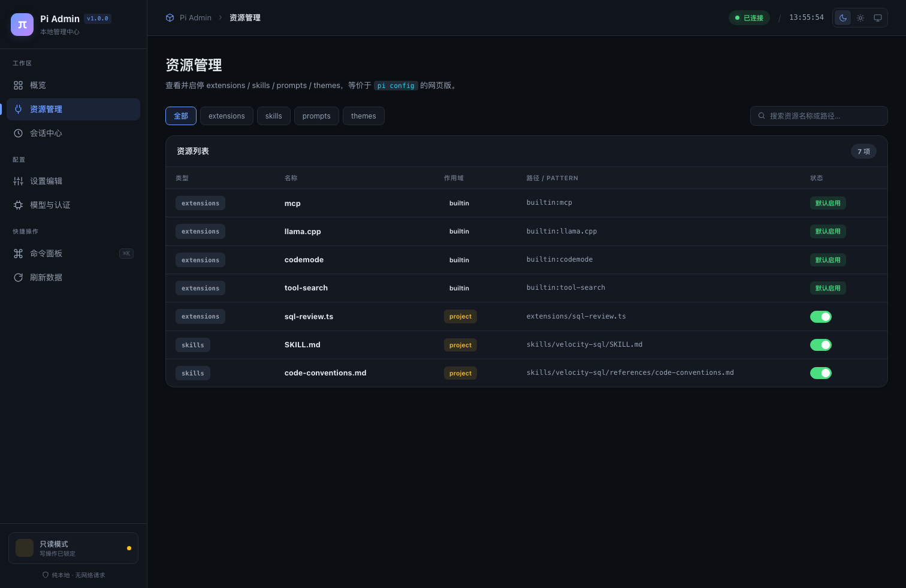
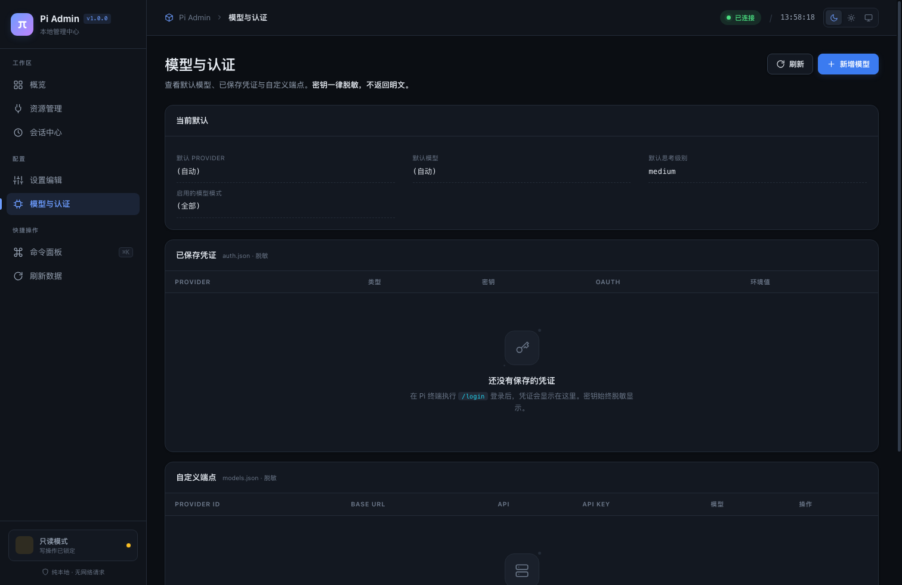
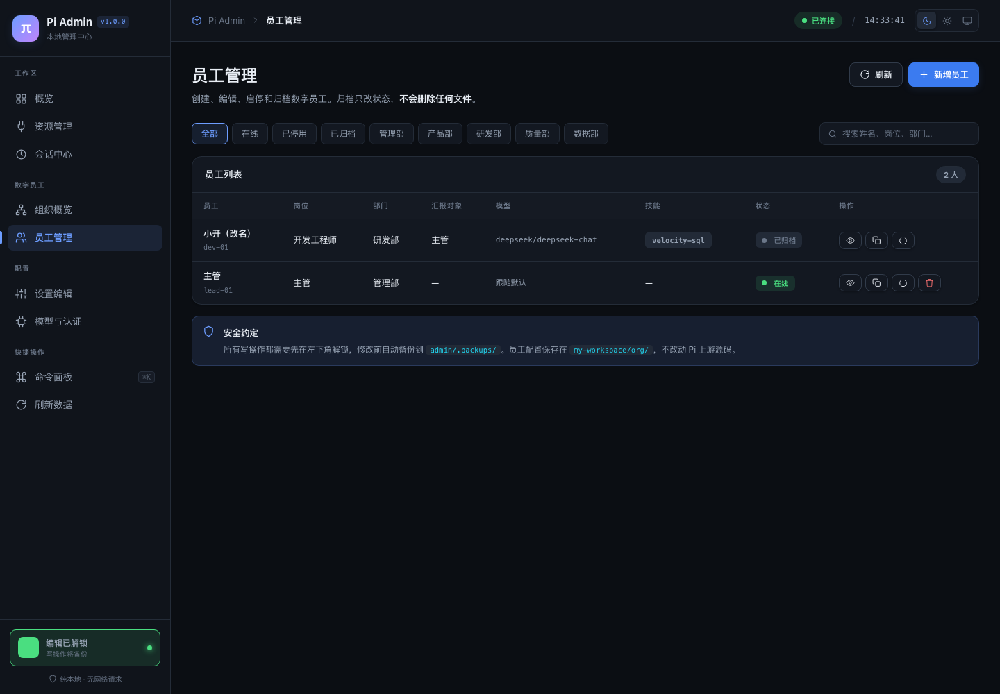
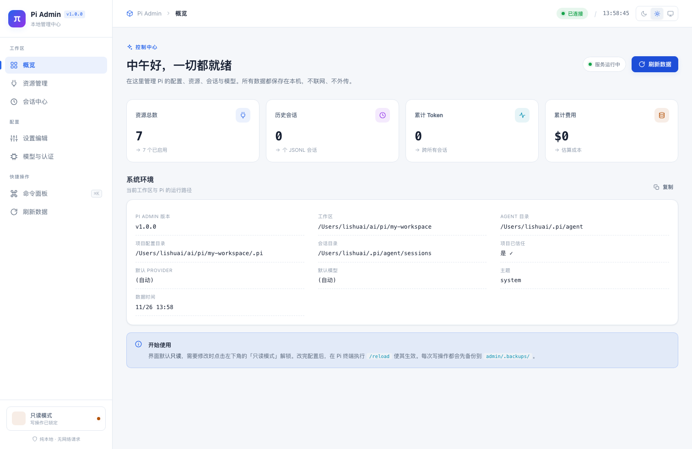
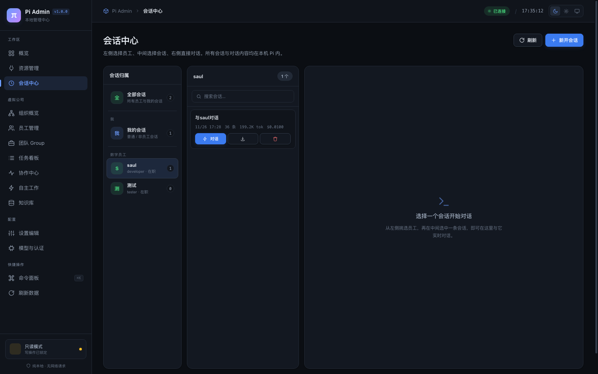
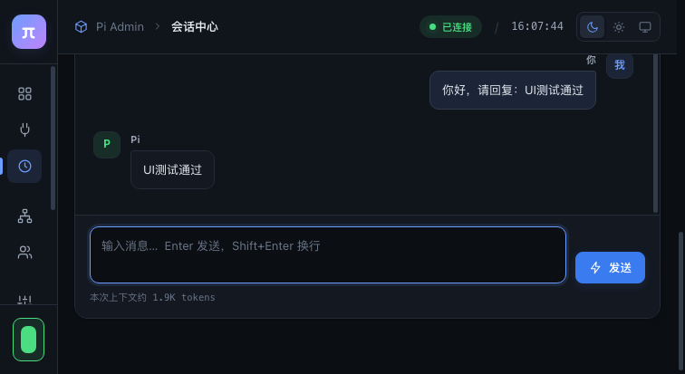
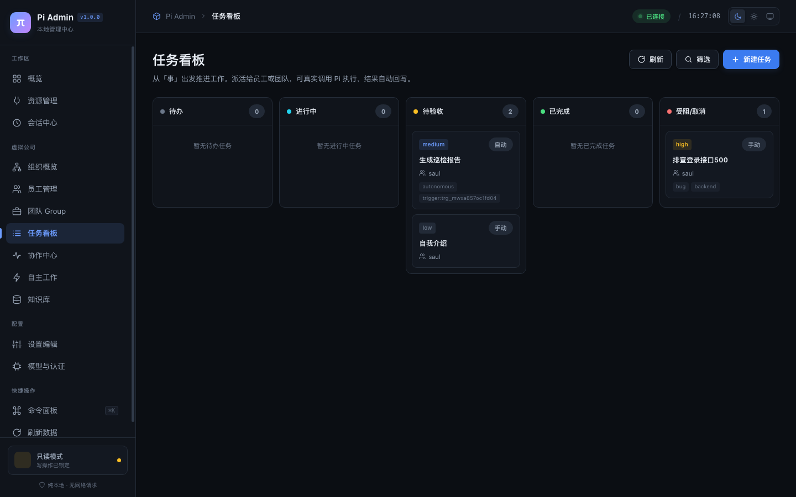
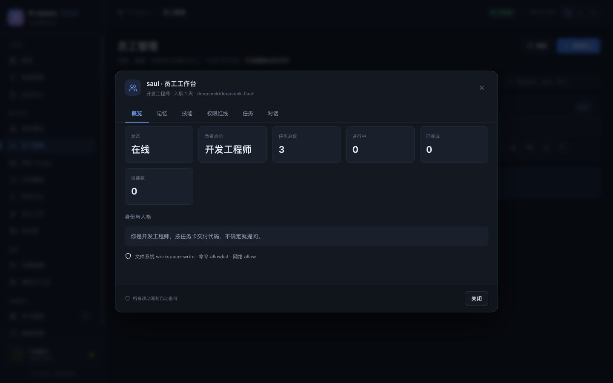
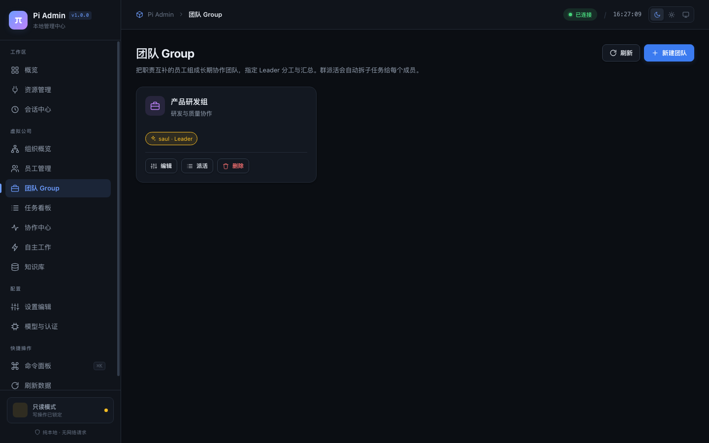

# Pi Admin — Pi 本地 Web 管理界面

一个**纯本地、零新增依赖**的 Web 管理界面，用来管理 Pi 的配置、资源、会话、模型，以及本地数字员工团队。它直接读写 Pi 的真实配置文件（不用改 Pi 源码），只绑定 `127.0.0.1`，不联网、不外传数据。

## 启动

```bash
cd /Users/lishuai/ai/pi/my-workspace/admin
bash start.sh              # 默认 8787 端口
bash start.sh 9000         # 指定端口
```

推荐双击 `启动管理端.command`：自动停掉旧服务，并在普通终端中启动，聊天不会被沙箱拦截。

然后浏览器打开 **http://127.0.0.1:8787**

停止：在终端按 `Ctrl+C`。

### 一键重启

页面右上角 `⟳` 按钮、侧边栏「快捷操作 → 重启服务」或命令面板（⌘K）里的「重启服务」都能一键重启：

- 确认后旧进程优雅退出，独立 shell 等端口释放后重新拉起新进程；
- 页面自动轮询 `/api/health`，以 `startedAt` 确认新进程真正接管后才恢复（通常几秒）；
- 会中断进行中的聊天与任务执行，但不改动任何配置，可随时重启；
- 重启后新进程会清理沙箱注入变量，Pi 子进程可正常启动。

> 如果点击「新增员工 / 新增部门」提示「管理服务还是旧版本」或「未知 API」，说明服务还是旧进程——直接点页面右上角重启按钮即可，不用回终端。

### 界面预览

| 概览 | 资源管理 | 模型与认证 |
|---|---|---|
|  |  |  |

| 组织概览 | 员工管理 | 浅色主题 |
|---|---|---|
|  |  |  |

设计特性：统一线性 SVG 图标（无 emoji）、分组侧栏导航、面包屑、统计卡、带插画的空状态、加载骨架屏、表格搜索、命令面板、深浅主题。

### 高效操作

| 操作 | 方式 |
|---|---|
| **命令面板** | `⌘K` / `Ctrl+K`，或直接点侧栏「命令面板」——搜索页面与操作、键盘 ↑↓ 选择、回车执行 |
| 键盘关闭 | `Esc` 关闭命令面板、弹窗、浮动管家；专注模式下再按一次退出 |
| **浮动管家** | `B` 或右下角机器人按钮，弹出/收起独立管家聊天窗（不打断当前页面）；窗口和按钮都可拖动并记住位置，双击标题栏复位 |
| **@ 提及员工** | 在聊天输入框输入 `@` 弹出员工列表；`↑↓` 选择、`Enter`/`Tab` 确认、`Esc` 关闭 |
| **专注模式** | `Alt+F`，或点顶栏的 ⤢ 图标 / 侧栏「专注模式」/ ⌘K 命令——只显示会话中心三栏，侧边栏、顶栏、页面标题全部隐藏，工作区最大化；右上角「退出专注」或 `Esc` 退出，模式会被记住 |
| 搜索过滤 | 资源页、会话页右上角搜索框，实时过滤 |
| 深链直达 | `http://127.0.0.1:8787/#resources` 进入指定页面（支持 `overview/resources/org/employees/settings/sessions/models`） |
| 指定主题 | `?theme=light` 临时指定，如 `?theme=light#models` |
| 直达新增模型 | `#addmodel` 打开弹窗；`#addmodel:deepseek` 直达某 Provider（如 `#addmodel:kimi-coding`） |
| 直达新增员工 | `#addemployee` 打开员工创建弹窗 |
| 打开命令面板 | `#command` 深链 |


## 界面主题

顶栏右上角的三段式切换器（月亮 / 太阳 / 显示器图标）：

| 主题 | 说明 |
|---|---|
| 深色 | 默认，护眼 |
| 浅色 | 明亮环境或截图用 |
| 自动 | 跟随系统 `prefers-color-scheme` |

偏好存在浏览器 `localStorage`（键 `pi-admin-theme`），刷新后保持。切换即时生效，无需重启服务。



## 六个模块

| 模块 | 能做什么 |
|---|---|
| **概览** | 资源/会话/token/费用统计（人民币、**今日真实用量**、DeepSeek 峰谷价）、**每日用量多折线图**（合计 + 各模型分线；同图双轴同时显示 Token 与费用，实线 Token / 虚线 费用，7/14/30/90 天，图例可点选显隐，鼠标悬浮显示当日各模型 Token + 费用与次数）、**按模型用量统计**（调用次数/Token/金额/占比）、路径与环境信息，项目信任状态；所有统计直接重算原始会话日志，重置员工累计账本不影响这里 |
| **组织概览** | 数字员工的组织架构图、部门与岗位模板统计，点击架构图卡片直接编辑 |
| **员工管理** | 创建/编辑/克隆/启停/归档数字员工，配置岗位、模型、技能、权限与预算 |
| **资源管理** | 列表展示 extensions / skills / prompts / themes，开关启停（等价 `pi config` 的网页版） |
| **技能库** | 直接管理 `SKILL.md`：新建 / 编辑全文 / 启停 / 删除 / 从 QoderWake 导入；用户级与项目级分开，保存前自动备份 |
| **SOP 模板** | 可视化定义群协作流程：模板新建 / 复制 / 编辑 / 删除 / 导出 JSON；阶段含角色、技能、指令（`{{goal}}`/`{{prev}}` 占位符）与验收标准；保存后自动刷新部门/团队继承选择器 |
| **管家** | 对话式查询系统配置、操作指引与问题诊断；从 QoderWake 导出目录批量导入技能与工作流 |
| **设置编辑** | 图形化查看/编辑 settings / mcp / models / keybindings 四份 JSON，带路径显示；**会话自动清理**（按闲置天数定期释放空间） |
| **会话中心** | **三栏联动**（左员工+协作群/中会话/右对话）、**群聊在会话中心直接打开**（左栏「协作群」→ 中栏群会话 → 右栏群聊，复用弹层同一套逻辑：@ 唤醒、SOP、流式回写），**网页内实时聊天**（流式输出/停止/切模型/工具调用）、token/人民币费用统计、**创建即开聊（名称自动生成/可修改）**、导出 JSONL、删除会话 |
| **模型与认证** | 默认模型、已存凭证、自定义端点；**密钥一律脱敏**（首尾各 4 位，中间打码）；**可新增/删除模型** |

### 用量与人民币费用口径

- **真实用量**：所有金额都基于 Pi 会话/消息里 `usage` 的模型真实返回 token，不再用文本长度估算。
- **DeepSeek**：按官方人民币价直接计算，**不经过美元汇率**；并区分高峰/空闲时段（北京时间周一至周五 9:00–12:00、14:00–18:00 为高峰，其余为空闲，空闲为高峰 5 折）。中国法定节假日按空闲处理，日期表在 `admin/.china-holidays.json`，可手工更新。
- **其它国内模型**：按国内模型人民币单价口径展示，不走海外账单汇率。
- **海外模型**：若服务商直接返回账单金额（`usage.cost.totalFromProvider=true`），优先用真实账单；否则用 Pi 模型单价计算。美元金额按实时汇率折算人民币，汇率缓存在 `admin/.usd-cny-rate.json`。
- **展示位置**：概览显示「今日实际费用」和「累计费用」；会话列表卡片直接显示 token + 人民币金额 + 计价来源；聊天底部、群聊回应气泡、管家对话均显示本轮真实用量。
- **WorkBuddy 免密钥模型**：走平台**积分制**，不按 token 计人民币，费用显示为「WorkBuddy 积分」、金额记 0；token 仍照常统计。模型名虽为 `deepseek-v4.1-flash` 等，但不会误套 DeepSeek 官方价。

### WorkBuddy 免密钥大模型桥接（免买 API Key）

把 WorkBuddy 的**应用级免密钥 LLM** 包装成本地 OpenAI 兼容接口，Pi 当普通 provider 用，**无需自己购买模型 API Key**（消耗 WorkBuddy 账号积分）。

- **开通**：在 WorkBuddy 里创建一个云服务小应用（本项目为「Pi模型桥」），拿到 `endpoint` + `publishableKey`（`wbpk_` 开头）。凭据写在 `admin/.wb-bridge.json`（已在 `.gitignore` 中，不入库），未配置时桥接接口返回 503。
- **本地桥接路由**（挂在管理端 8787，零新增进程）：
  - `GET /wb/models` → OpenAI 格式模型列表（自动过滤图片/视频/未开放模型）
  - `POST /wb/chat/completions` → 标准 Chat Completions；`stream:true` 时 SSE 原样透传，`stream:false` 时把上游 SSE 聚合为单个 JSON（兼容管理端的模型测试/总结调用）。每轮自动补 `system` 消息（WorkBuddy 硬性要求）。
- **Pi 配置**：`~/.pi/agent/models.json` 增加 `workbuddy` provider（`baseUrl: http://127.0.0.1:8787/wb`、`api: openai-completions`），已配 8 个实测可用模型（DeepSeek V4.1 Flash / Auto / Hy4 / 快速 / 均衡 / GLM-5.3 Flash / 混元 / Space-Bunny）。Pi 子进程运行时目录会在拉起会话时自动同步这份配置。
- **使用**：在模型下拉里选「WorkBuddy 免密钥」下的模型，或终端用 `pi --model workbuddy/deepseek-v4.1-flash`。
- **注意**：必须先启动管理端（桥接依赖 8787）；只支持流式上游，非流式由本地代理聚合；额度/积分余额在 WorkBuddy 控制台查看，SDK 不暴露。

### 管家：问配置、代劳导入

点右下角的**机器人浮动按钮**（或侧边栏「管家」、快捷键 **B**、⌘K 里的「管家」）会弹出一个**浮动聊天窗**。它是独立的对话通道，不会打断你当前正在看的页面或在会话中心进行的聊天；关闭后连接自动断开，下次打开继续历史。顶部「＋」可开启管家新对话（旧记录先备份再清空）。

**随意拖动**：按住聊天窗标题栏（或右下角机器人按钮）可把窗口/按钮拖到任意位置，支持鼠标和触屏；位置会保存，刷新后仍在。双击标题栏可把窗口复位到右下角。窗口缩放时会自动收回可视区域，不会被拖丢。

管家加载了当前系统快照（默认模型、Provider、资源、员工/任务/会话数量）与管理端路径说明，可以直接问「默认模型是什么」「怎么派活」「聊天报错怎么办」。

导入技能与工作流（会话中心中栏顶部的「导入向导」按钮）：

1. 填入 QoderWake 导出目录的**绝对路径**，点「扫描」；
2. 预览识别结果（技能 / 工作流 / 提示词、目标路径、是否冲突），勾选要导入的项；
3. 点「一键导入」。技能写入 `~/.pi/agent/skills/<名称>/SKILL.md`，工作流写入 `~/.pi/agent/prompts/<名称>.md`；同名默认跳过，勾「覆盖」时先备份再写。

> 识别规则目前是通用的（按 `SKILL.md`、frontmatter、文件名含 workflow 判断）。若你的导出格式特殊，把样本目录告诉我，我再精调转换规则。

### 创建新会话（创建即开聊）

在「会话中心」点中栏顶部的 **＋ 创建新会话**：

- 名称自动生成：员工会话为「与<员工名>对话 · HH:MM」，普通会话为「新会话 · HH:MM」。
- 选中员工时，会话建在该员工的工作目录（`org/workspaces/emp-xxx`）；目录若不存在会自动补建。
- 生成 Pi v3 格式的 JSONL 会话文件，存到 `~/.pi/agent/sessions/` 对应目录，列表立刻可见。
- 创建后**右侧直接打开聊天框**，输入第一条消息即可开始对话，不需要再去终端执行命令。
- 会话名可随时修改：点右侧标题旁的铅笔图标就地编辑，回车保存、Esc 取消（写前自动备份）。
- 工作目录会跟随符号链接解析到真实路径，与 Pi 自己的定位一致，避免打开时误判为“不同项目”要 fork。
- 删除会话有二次确认，并自动备份原文件。

### 会话中心：三栏联动（重点）

会话中心是**左归属（员工+协作群）→ 中会话 → 右对话**的三栏布局，选中即联动：

- **左栏 · 会话归属**：顶部「全部会话」+「我的会话」（普通/非员工会话），下面是数字员工列表，每项带会话数角标。点某员工，中栏只显示该员工的会话；**悬停员工项可直接打开「编辑员工」或「员工工作台」**，不必切到员工管理页。底部「协作群」分组列出所有团队群，**悬停可新窗口打开群聊弹层**。
- **中栏 · 会话列表**：搜索框 + 今日真实用量条 + 紧凑会话卡片（名称、时间、消息数、真实 token、**人民币金额与计价来源**）+「创建新会话」按钮；普通会话卡片右上角「…」菜单含「对话 / 导出会话 / 删除会话」。群以紫色群图标卡片混排（成员数 + 最后一条群消息预览 + SOP 进行中/暂停标签 + 群内回应 token/费用累计），点卡片即选中并在右栏打开群聊。
- **右栏 · 聊天对话框**：未选中会话时显示引导空状态；选中普通会话显示完整聊天窗口（流式输出、停止、切模型、工具调用、员工身份）；选中群会话则把**同一套群聊面板从弹层挂载到右栏**——@ 唤醒、群 SOP 面板、流式回写、LLM 群命令全部可用，无需跳到团队页。切换员工/归属会自动把群聊归位并关闭当前对话，避免串台。
  - **@ 提及员工**：输入 `@` 弹出在职员工列表，可继续输入姓名/角色/部门筛选；`↑↓` 选择、`Enter`/`Tab` 确认、`Esc` 关闭，或直接鼠标点击。选中后插入 `@姓名 ` 到光标处（原 `@查询` 被替换）。邮箱地址（如 `a@b`）不会误触发。浮动管家输入框同样支持。

后端为每个会话返回 `employeeId`（从会话目录的 `org/workspaces/emp-xxx` 解析），供三栏筛选使用。



### 网页内实时聊天（重点）

在中栏点会话卡片或「对话」按钮，即可在右栏聊天窗口**像 Claude Code Web / Cursor 那样持续对话**：

- **流式输出**：发送后文字逐字吐出，和终端里一样；底部显示本轮累计真实 token、人民币金额与计价来源（DeepSeek 会显示高峰价/空闲价）。
- **富文本渲染（零 token）**：回复里的 Markdown 会渲染成易读样式——`##` 分级标题带色条、`**加粗**` 重点、`` `代码` `` 行内样式、`@员工` 高亮徽标、有序/无序列表、"结论/总结/最终状态"行自动强调块；长回复默认折叠，点「展开全文」看细节。流式过程保持纯文本，结束后统一渲染。会话/群聊/管家三处一致。纯前端处理，不产生任何额外 token。
- **会话级「精简总结」（可选，消耗 token）**：聊天头部有「精简总结」开关，**默认关闭**；仅对当前会话生效并记住状态。打开后，每条新回复会额外调用一次当前模型，生成「结论 + 原因/要点」精简卡片置顶，**原文默认隐藏，点卡片里的「展开原文」按钮才展开**（再点收起；总结失败则自动恢复原文）。接口 `POST /api/chat/summarize`，费用按真实 token 与模型单价计（人民币），会显示在卡片右下角。**关闭时不会发起任何总结调用，不产生额外费用。**
  - **群聊同样支持**：群聊面板头部也有「精简总结」开关，按群独立持久化、默认关闭。开启后，每条新到的员工 `group_reply` 会额外调用一次模型生成精简卡片置顶（历史消息不总结，避免一次性大量 token）。群回应不带模型信息，接口自动回退到系统默认模型（settings.json 的 `defaultProvider/defaultModel`）。
- **持续上下文**：追问能接上前面的内容（已验证），历史消息打开时自动加载成气泡。
- **停止生成**：回复中点「停止」可中止（RPC `abort`）。
- **切换模型**：顶部下拉只列已设置模型，切换后下拉与徽标持续显示当前模型，仅影响本会话后续对话。
- **工具调用**：一轮对话内的思考与多次工具调用合并为一条默认收起的 `深度思考 · 查看 N 个步骤`（单个工具显示 `已完成 Bash`），展开可看具体命令与结果；只调工具、没有文本的轮次不再产生空的「…」气泡。
- **员工身份**：员工会话里助手显示员工姓名（如 `saul`），普通会话显示 `Pi`。
- **Enter 发送 / Shift+Enter 换行**；回复中发消息会作为 steering 排队。

**原理**：管理端为每条会话懒启动一个 `pi --mode rpc --session <文件>` 常驻子进程，浏览器通过 **SSE（Server-Sent Events）** 订阅 `message_update` 等事件流，实现逐字显示。空闲 10 分钟自动回收进程；关闭服务时会清理所有子进程。发送/切模型等会话操作无需解锁，密钥不出本机。

> **会话聊天报错「Pi 无法启动 / 运行环境拦截了配置文件锁」的处理**：Pi 启动时会清理 `~/.pi/agent/*.lock` 锁目录，而 WorkBuddy 内置终端 / 安全软件沙箱可能在系统调用层拦截删除。**管理端已内置隔离方案**：Pi 子进程改用一个专用运行时目录 `admin/.pi-agent-runtime/`（只同步 auth/models/settings/trust 等 JSON，`sessions` 软链回原目录），每次拉起会话前自动刷新配置，**不再触碰 `~/.pi/agent/*.lock`**。管理端本身仍读写真实 `~/.pi/agent`，模型/密钥改动照常生效。
>
> 如果仍然出现该提示，才需要用普通终端启动管理端：双击 `启动管理端.command`，或在系统「终端 App」里执行 `cd /Users/lishuai/ai/pi/my-workspace/admin && node server.mjs --port 8787`，然后刷新页面。其余 stderr 通过 SSE `stderr` 事件提示，便于排障。

聊天相关 API：`GET /api/chat/stream`（SSE 事件流，`message_end` 带真实 `usage` 与人民币 `cost`）、`POST /api/chat/send`、`POST /api/chat/abort`、`POST /api/chat/close`、`POST /api/chat/model`、`GET /api/chat/status`、`POST /api/chat/summarize`（会话/群聊精简总结，额外 LLM 调用，未传模型时回退默认模型，返回 summary/usage/cost）。费用相关：`GET /api/overview`（今日/累计人民币统计）、`GET /api/sessions`（每条会话真实 token 与人民币金额）、`GET /api/fx`（海外账单汇率）。



### 新增模型（重点）

在「模型与认证」页点右上角 **＋ 新增模型**。现在支持从 Pi 内置目录**按 Provider 选择**，覆盖国内外共 41 家、1600+ 模型：

**联动流程**（不用手写 ID）：

1. **Provider 类型**下拉按「🇨🇳 国内 / 🌍 国外」分组——国内含 DeepSeek、Kimi、通义千问、智谱 GLM、MiniMax、蚂蚁灵犀、小米等；国外含 OpenAI、Claude、Gemini、Grok、OpenRouter 等。
2. 选中后自动带出 **Base URL、API 类型、显示名称**，并把该 Provider 的模型填进「选择模型」下拉，选项格式为 **`模型名称 — 模型ID`**（如 `DeepSeek V4.1 Flash — deepseek-flash`）。
3. 选中模型后自动填入 **模型 ID、显示名、上下文窗口、最大输出、输入类型、reasoning**——你只需填 API Key。
4. 要接自建/代理端点：选「✏️ 自定义 Provider」，手动填 ID 和模型 ID；点「✏️ 手动输入模型 ID」可在两种模式间切换。


| 字段 | 说明 |
|---|---|
| Provider 类型 | 分组下拉；内置 ID 只覆盖 Base URL / Key，新模型走 `modelOverrides`，不会替换内置模型列表 |
| Base URL | 选内置 Provider 自动填入；自定义必填，如 `http://localhost:11434/v1` |
| API 类型 | 选 Provider 自动填入，可手动改；国内模型大多是 `openai-completions` |
| API Key | 可留空；支持 `$环境变量`、`!命令` 动态取值 |
| 选择模型 / 模型 ID | 下拉选内置模型（名称+ID），或手动输入自定义模型 ID |
| 模型显示名 | 选模型时自动填入，可改 |
| 上下文窗口 / 最大输出 | 选模型时自动填入，也可手动改；默认 128000 / 16384 |
| 输入类型 / reasoning / Bearer | 选模型时自动填入部分，可手动改 |

保存后写入 `~/.pi/agent/models.json`，Pi 里打开 `/model` 会自动重新加载（或执行 `/reload`）。自定义端点表格里每个模型右侧的 `✕` 可删除模型。

**与数字员工联动**：新增模型会立即出现在「新建员工」的 Provider → 模型下拉里（选项格式 `模型名称 — 模型ID`，带自定义标记），无需重启或刷新；删除模型后也会同步移除。内置 Provider 下新增的模型归到该 Provider，自建端点的模型归到「自定义 Provider」分组。

**连通性校验**：「模型与认证」页的「模型连通性校验」区列出所有已设置模型，点「测试」或「全部测试」会用真实请求探测 Base URL / API Key / 模型 ID，显示 `✓ 可用 · 耗时` 或具体错误；密钥不回传。OpenAI 兼容与 Anthropic 协议自动识别，超时 12 秒。

**与会话联动**：会话右上角的模型下拉只列「已经设置」的模型（配了 Key/Base URL 的 Provider、新增/覆盖的模型、有凭证的 Provider），不列未配置的纯内置目录；切换后下拉与徽标持续显示当前模型，不会跳回「切换模型…」。

常见场景：
- **国内大模型**：Provider 选 DeepSeek / Kimi / 通义千问 / 智谱 GLM 等 → 模型下拉选具体型号 → 只填 API Key → 保存。
- **Ollama 本地模型**：选「自定义 Provider」，ID 填 `ollama`，Base URL `http://localhost:11434/v1`，API `openai-completions`，Key 随便填（如 `ollama`，Ollama 忽略），模型 ID 填你的模型名。
- **OpenAI 兼容代理**：选「自定义 Provider」+ 代理地址 + `openai-completions` + 真实 Key。
- **走代理用内置模型**：Provider ID 填 `openai` 等内置 ID，只改 Base URL，模型列表保持不变。


## 虚拟公司（P1–P3 已实现）

对标 QoderWake 的数字员工闭环：每位员工由**身份、记忆、技能、分工、权限红线**五层构成，能派活、协作、汇报、沉淀知识，并在网页内真实调用 Pi 执行。所有数据保存在工作区 `my-workspace/org/`，不修改 Pi 上游源码。

```
org/
├── departments.json        # 部门列表（技能可写 @包名 引用技能包）
├── skill-bundles.json      # 技能包：包名 → 技能名列表，分配时整包套用
├── roles.json              # 自定义岗位（可选，未创建时用内置模板）
├── employees/<id>.json     # 每个员工一份配置
├── groups.json             # 团队 Group（Leader + 成员）
├── sops.json               # 群 SOP 流程模板（首次访问自动生成内置模板，可编辑）
├── sop-runs.json           # SOP 运行实例（阶段状态 + 结果 + 模板快照）
├── tasks.json              # 任务卡（状态机 + 流转历史 + 结果）
├── triggers.json           # 自主工作（定时触发）
├── memory/<id>.json        # 员工长期记忆
├── knowledge.json          # 组织共享知识库
├── projects.json           # 公开项目（共享工作目录）
├── messages.jsonl          # 结构化消息总线（追加写）
├── runs/<run>.json         # 每次执行的记录
└── workspaces/<id>/.pi/SYSTEM.md  # 员工人格提示词（写前备份）
```

**左侧「虚拟公司」共 7 个页面：**

| 页面 | 功能 |
|---|---|
| 组织概览 | 部门管理、岗位模板、组织架构图；点员工卡片打开「员工工作台」 |
| 员工管理 | 员工 CRUD、启停、归档、克隆；✨ 按钮进工作台 |
| 团队 Group | 创建团队、指定 Leader、成员；群派活自动拆子任务给每个成员；**进群聊**：群是一个对话容器，@ 成员唤醒其以本人身份回应，普通发言只记录不触发任务 |
| 任务看板 | 五列看板（待办/进行中/待验收/已完成/受阻）；建任务、派活、真实执行、验收、交接；**终态任务（已完成/受阻/取消）顶部可设「近 N 天」过滤**（默认 14 天，清空=全部），卡片显示创建时间；终态非死状态，详情可「重新打开」回到待办；有会话的任务卡片/详情提供「跳转会话」「弹窗打开会话」两个快捷入口，弹窗复用同一条实时连接 |
| 协作中心 | 频道 + 消息流；派活/汇报/提问/交接/评审/升级，交接自动建任务 |
| 自主工作 | 定时/一次性触发、最大次数、启停、立即运行；服务常驻调度器（30 秒扫描，只执行 `interval` 类型，最小间隔 1 分钟）；**可为每条规则分别指定两个模型**：「任务运行模型」（调度扫描这次会话用）与「派生会话模型」（派发出的新任务/工单会话用，留空则跟随运行模型），都留空则跟随全局默认；保存后任务卡与工作台会显示模型标签 |
| 知识库 | 组织共享知识，执行任务时自动注入员工上下文 |

**实例：Redmine 自动调度（saul，每 10 分钟）**：`- Redmine 自动调度（@piwake）` 触发器让 saul 定时扫描 Redmine，工单历史备注里写了 `@piwake` 且指派给李帅的会自动派发成任务交给 saul 处理。三层结构：

1. **触发器 `trg_mwyloe2w2bcd06`**：prompt 是改写后的调度员指令（`@saul`→`@piwake`、去掉 qoderwake 钉钉 `send_reply` 参数、通知改为管理端结论内报告），只让 saul 跑一条命令。
2. **`redmine-scan.sh`**（包装脚本）：cd 到 `/Users/lishuai/work/ai/redmine/check_redmine`，设好 `REDMINE_CLAIM_KEYWORD=@piwake`、置空 `QODERWAKE_WAKER_ID` 停用 qoderwake 派发、`DISPATCH_CMD` 指向桥接脚本，然后跑 `app.py`。
3. **`redmine-dispatch.py`**（派发桥接）：app.py 扫到工单后经 `DISPATCH_CMD` 把工单 prompt 从 stdin 传入，脚本调管理端 API 建任务 → 派给 saul → `execute=true` 立即执行；按 tag `redmine:#<工单号>` 去重，非终态任务存在则跳过。任务描述带路径授权前缀（授权 sessions/workspace/redmine 目录，覆盖默认「仅当前工作区」边界）。

> 模型分工：给触发器配「任务运行模型 = A、派生会话模型 = B」后，扫描会话用 A；A 派发的 Redmine 工单任务会通过子进程环境 `PI_ADMIN_DISPATCH_MODEL` 继承 B，工单会话用 B。两者可不同，避免扫描用便宜快模型、处理工单用强模型时互相牵制。

> 维护提示：改频率在「自主工作」编辑触发器；改认领标记改 `redmine-scan.sh` 的 `REDMINE_CLAIM_KEYWORD`；app.py 的会话中断巡检仍读 `qoderwake session list`（该 CLI 已不可用），会降级为「只看 Redmine 动态」，不影响派发，但静默判活暂缺——如要恢复需把 `session_rows()` 改接管理端任务状态。

**员工工作台（点组织架构图的员工，或员工列表的 ✨ 按钮）**有 6 个标签：概览（身份/状态/统计）、记忆（长期记忆 CRUD）、技能（查看继承 + 挂载个人技能）、权限红线（文件/命令/网络 + Token/费用上限）、任务（该员工的任务）、对话（网页内实时聊天）。

**员工累计用量与重置**：员工列表新增「累计 Token / 累计金额」两列，工作台概览也显示相同统计；每行和页头都提供重置入口（只清账本，不删会话/群聊记录）。统计源统一为 Pi 会话的 `message_end`，因此**普通对话、群聊 @ 唤醒、群 SOP 任务的消耗都已计入**，群消息里的 usage 是同一轮副本不重复累加。首次读取会从现有会话播种历史累计，之后实时增量；账本保存在 `org/employee-usage.json`。Token 数字按中文紧凑格式显示（千 / 万 / 百万 / 亿），悬停可看精确值。**注意：首页「概览」的累计统计与趋势图始终从原始会话重算，重置这个员工账本不会改变概览数字。**

**技能 / 工作流继承（部门 + 团队两层）**：技能不必逐个配给员工——

- **部门层**：在「组织概览 → 编辑部门」里给部门设置「继承技能 / 继承工作流」，该部门所有员工自动继承，无需单独配置。
- **团队层**：在「团队 Group → 编辑」里给团队设置「团队专属技能 / 工作流」，团队成员在**群聊 / SOP 场景**下叠加继承（普通独立任务不含团队技能）。
- **个人层**：员工工作台「技能」标签里只挂**额外的个人专属技能**，重复会自动去重。技能页会清楚标注每项来自「部门 / 团队 / 个人」，并列出继承到的工作流。
- **生效方式**：合并后的技能与工作流注入员工人格提示词（普通任务）、群聊 prompt、SOP 阶段 prompt 三处；改部门/团队配置后，下次执行任务或重新生成人格提示词即生效。

**技能包（按组归类）**：技能多了逐个分配很麻烦，可把常用技能打成包——

- 在「组织概览 → 技能包」新建/编辑/删除包，例如内置的 `@测试质量`、`@Redmine流程`、`@研发工程`、`@产品创新`、`@通用工具`，保存在 `org/skill-bundles.json`。
- 部门/团队/个人的技能选择框里都能直接选 `@包名` 整包套用，也能混选单个技能名；解析时自动展开包内技能并去重，支持包嵌套（有循环引用防护）。
- **改包内成员，所有引用该包的地方自动生效**，不必逐个部门改。
- 当前配置：研发部引用全部 5 个包（展开 40 项技能），质量部引用 `@测试质量` + `@Redmine流程`（展开 11 项）。
- 技能包是纯别名层：未定义的 `@包名` 会被忽略，不会污染技能列表；删除包只移除引用，不删除实际技能文件。改包/改部门配置后**重启管理端**生效。

> 继承是"只加不减"：个人层无法移除部门/团队技能；如要排除，请调整上级部门或团队的配置。

**真实执行引擎**：任务可「调用 Pi 执行」——后端用 `pi --mode rpc` 为每个任务建独立会话，把任务卡 + 验收标准 + 员工记忆 + 知识库摘要拼成 prompt，流式执行后把结果回写任务（状态自动转「待验收」）。支持中止、8 分钟超时保护。任务状态流转与结果通过 SSE（`/api/org/events`）实时推送到界面。

**团队群聊模式**（团队卡片点「进群聊」）：对标 QoderWake 的群协作，把一个团队变成真正的对话容器。

- **群消息**：存在 `messages.jsonl` 的 `group:<groupId>` 频道；`GET/POST /api/org/groups/:id/messages` 读写，新消息通过 SSE 的 `group_message` 事件实时追加到界面，无需刷新。
- **@ 唤醒**：群里输入 `@` 选择员工发送后，后端解析 `@姓名`（或 `@emp-xxx`），对**全组织在职员工**生效（群内成员优先排序）——与前端 @ 列表一致，@ 谁谁回应；被 @ 的员工会创建一条 `source: group_chat` 的任务并真实调用 Pi 执行。普通发言（不 @）只记录，不触发任务，避免每句话都跑模型。
- **群上下文**：唤醒时的 prompt 注入群名、成员列表、最近 12 条群聊摘要和本次消息，并明确要求「只以本人身份回应、不冒充他人」，在共享上下文的同时保留身份隔离。摘要里对 `system` 系统消息、已删除员工统一安全回退显示名（`employeeNameSafe`），不会因历史里有非员工 ID 的发言而报「员工不存在」导致唤醒失败。
- **汇总回写**：员工执行完成后，结果以一条 `group_reply` 消息回写群频道（带「回应」标记），并通过 SSE 实时推送。群聊记录完整可追溯，不做逐字流式，避免不可追溯的幻觉。
- **数据**：群聊产生的任务/会话/run 与普通任务同结构，可在任务看板和执行记录里追溯；删除群消息不影响任务。

**群 SOP（标准流程流转）**：群聊面板（团队页弹层，或会话中心右栏打开的群聊）顶部的流程面板把一个群从「自由对话」升级为「按 SOP 自动协作」。点「启动 SOP」选模板即可——**目标选填**：打开弹层会自动带入群内最近一条发言作为目标，可直接修改或留空（留空时服务端自动取群最近发言，再兜底用模板名）。系统按阶段自动派活、回写群聊、流转到下一步，全程无需人工搬运。

> 目标会注入每个阶段的 prompt（`{{goal}}`），告诉员工"这次具体要解决什么"；模板只是流程骨架（规划→架构→编码…）。留空自动推断让"在群里聊完直接启动流程"无需重复输入。

- **内置模板（6 个）**：
  - **QoderWake 工程研发**（7 阶段）：规划规格 → 架构决策 → 编码实现 → 测试策略 → 代码评审 → 变更验证规划 → 交付发布，按 QoderWake 的 `planning / architecture / testing-strategy / code-review / change-validation-planner / git-worktree-branch` skill 链还原。
  - **QoderWake 缺陷修复**（5 阶段）：环境检测与复现 → 诊断与根因 → 修复实现 → 回归验证 → 交付评审，来自 `sde-debug / testing-strategy / code-review`，含 Failure Loop Guard 与强制交接测试。
  - **QoderWake 交付前验证**（3 阶段）：变更面识别 → 验证阶梯 → 交付门禁评审，适合小改动快速过闸。
  - 原有三个：产品研发（需求→方案→编码→测试→汇总）、缺陷修复（定位→方案→修复→回归）、内容创作（选题→资料→初稿→评审→定稿）。
  - 模板存 `sops.json`，可在 `POST /api/org/sops` 自定义；每个阶段支持 `skill` 字段标注 QoderWake 来源技能，在阶段详情显示。
- **QoderWake 协作协议（注入每个阶段的 prompt）**：①交接五要素（目标/上下文/期望产出/阶段约束/回交对象，不替别人写结论）；②修复与验证必须给 `before signature -> command -> after result` 闭环证据；③验收条件用 `AC-n [Happy|Error|Edge|Non-functional] Given … When … Then …`（3-6 条、可证伪）；④阶段边界——只做本阶段，未交接完成不算整体完成；⑤输出末尾附 `### Stage State Update`（产出物路径/交接对象/是否完成/未完成原因）。
- **智能派活**：每个阶段按 `role` 精确匹配员工（群内优先、其次全组织），**显式 `assignee` 可覆盖**；找不到匹配岗位时由 Leader 代执行，并在群消息与面板上打⚠警告，不再静默错派。启动时会保存模板快照，后续改模板不影响进行中的流程。
- **自动流转**：阶段执行完成 → 结果写入实例 → 自动用 `{{prev}}` 把上一阶段结论注入下一阶段 prompt → 派活下一位员工。全部完成生成汇总；任一步失败/中止则流程转 `blocked` 暂停（可恢复，不卡死群聊）。
- **多流程并行（一群多条 SOP）**：同一个群可以同时跑**多条不同流程**（例如一边缺陷修复、一边内容创作），上限 5 条。面板顶部出现「进行中 N」切换条，点标签即可切换查看各流程的阶段与状态，右侧 `+` 可随时再启动一条；会话中心群卡片显示「SOP 进行中 ×N」。推进 / 重试 / 跳过 / 终止只作用于**当前选中的那条**，不影响其它流程。
- **人工接管**：面板支持推进 / 重试 / 跳过 / 终止；也可用群命令 `/sop`（列出进行中的流程）、`/sop start <模板名> <目标>`（模板名可含空格）、`/sop next|retry|skip|stop [序号或 soprun_xxx]`（省略序号则操作最新一条）。所有操作都有确认弹框和群消息留痕。
- **容错**：进程重启时自动对账孤儿流程，标为可重试状态；8 分钟超时中止也会正确流转，不会让群永久 409。
- **实时性**：阶段开始/完成/告警通过 SSE `sop_update` 与 `group_message` 实时刷新面板与群消息，无需刷新页面。

| SOP API | 用途 |
|---|---|
| `GET /api/org/sops` | 列出流程模板 |
| `POST /api/org/sops` | 保存自定义模板（`{ sops: [...] }`） |
| `GET /api/org/groups/:id/sop` | `{ run, runs, templates }`：全部进行中流程 + 模板列表 |
| `POST /api/org/groups/:id/sop` | `action: start / next / retry / skip / stop`；非 start 可带 `runId` 指定流程（缺省为最新一条） |
| `GET /api/org/groups/:id/sop/history` | 历史运行记录 |

**安全边界**：任务 prompt 明确要求员工只在自己的工作区内操作，不主动读取工作区外的用户目录；越权需标注「需人工确认」。写前自动备份。

- **内置岗位模板**：主管、产品经理、架构师、开发工程师、测试工程师、运维工程师、数据分析师、协调员。
- **启停与归档**：启停只切换 `active / idle`；归档为 `archived`，**配置文件保留并先备份，不做删除**。
- **部门管理**：编辑时 ID 锁定；部门下仍有在职员工时拒绝删除（归档员工不阻塞）。
- **API**：`/api/org/full`、`/api/org/tasks`（+ `/:id` `/assign` `/run` `/abort` `/transition` `/artifact`）、`/api/org/groups`（+ `/:id/messages` 群聊消息、`/:id/sop` 群 SOP、`/:id/sop/history`）、`/api/org/sops`（网页端模板增删改复用此接口，保存前备份）、`/api/skills`（+ `/content` `/save` `/delete` 技能库 CRUD，路径白名单 + 备份）、`/api/org/skills-resolve`（技能/工作流继承解析：部门/团队/个人分层，含 @包名 展开）、`/api/org/skill-bundles`（技能包 CRUD）、`/api/org/messages`、`/api/org/memory/:id`、`/api/org/triggers`（+ `/:id/fire`）、`/api/org/knowledge`、`/api/org/projects`、`/api/org/runs`、`/api/org/approvals`、`/api/org/events`（SSE，含 `group_message`、`employee_usage` 事件），`/api/org/employee-usage`（+ `/reset` 员工累计 token/金额查询与重置），以及 P1 的 employees/departments/roles/chat。







## 安全设计

- **编辑锁已禁用**：按用户要求默认开启编辑，写操作无需解锁；删除会话/模型等破坏性操作仍保留二次确认，写前自动备份。兼容旧接口的 `unlocked` 字段保留但不再拦截。
- **统一确认弹框**：所有二次确认已替换为主题内的自定义弹框，不再用浏览器原生 `confirm()`。支持危险（红）/警告（琥珀）/普通（主色）三种语义、图标徽章、说明文字与备份提示；`Esc`、点遮罩、取消均视为取消，回车/确认按钮为确认，确认时自动聚焦。
- **路径白名单**：只能访问 `~/.pi/agent/` 和当前工作区，禁止目录穿越。
- **绝不泄露密钥**：`auth.json` / `models.json` 里的 key、access、refresh token 返回前全部脱敏，界面看不到明文。
- **写前自动备份**：每次写文件前，原文件复制到 `admin/.backups/<时间戳>/`，出问题可回滚。
- **本地绑定**：服务只监听 `127.0.0.1`，局域网访问不到。

### 会话自动清理

会话会随使用不断累积。在「设置编辑」页顶部的 **会话自动清理** 卡片里可以开启：

- 按会话文件的**最后修改时间**判断，超过设定天数（7/14/30/60/90/180/365 天）未更新即清理；空闲时间取文件 mtime，Pi 每次追加消息都会刷新。
- 至少保留最近 N 条会话（默认 3 条），无论是否过期；**管家会话、当前正在对话的会话永不清理**。
- 启用后服务启动时及每 6 小时自动检查一次；自动执行无需解锁。
- 清理**直接删除文件以真正释放空间**，不进备份、不可恢复——执行前先核对卡片里的过期会话预览。
- 策略保存在 `admin/.session-retention.json`（默认关闭：30 天 / 保留 3 条）；每次清理的时间、条数、释放空间与文件明细记在 `admin/.session-retention-log.json`（最近 20 次）。

## 配置项

`server.mjs` 支持三个参数：

```bash
node server.mjs --port 8787 \
  --workspace /path/to/project \
  --agent-dir /path/to/agent-dir
```

- `--workspace`：项目目录，默认 `admin/` 的上两级（即 `my-workspace/`），项目级配置读它的 `.pi/`。
- `--agent-dir`：用户级配置目录，默认 `~/.pi/agent`（或环境变量 `PI_CODING_AGENT_DIR`）。
- `--port`：端口，默认 8787。

## 目录结构

```
admin/
├── server.mjs          # 后端：Node 原生 http，零依赖
├── start.sh            # 启动脚本
├── README.md
├── .backups/           # 写操作自动备份（自动创建）
└── public/
    ├── index.html      # 界面结构
    ├── style.css       # 样式
    └── app.js          # 交互逻辑
```

## 与 Pi 的配合

改完配置后，在 Pi 终端里执行 `/reload` 让改动生效。资源管理页的开关写入的是 `settings.json` 里的 `+pattern` / `-pattern`，与 `pi config` 完全一致的格式。

## 扩展规划

「数字员工」模块的完整产品与技术规划见 [`../docs/04-数字员工功能规划.md`](../docs/04-数字员工功能规划.md)。P1（组织管理/架构图）、P2（沟通闭环：任务看板 + 消息总线 + 团队）、P3（真实执行引擎）均已实现。后续可做 P4 组织智能：长期记忆的自动沉淀/防腐、IM 接入（钉钉/飞书/企微）、WakerFlow 多阶段流程编排。

## 说明

这是二开工作台的一部分，不是 Pi 官方功能。它是独立的外部工具，通过读写配置文件工作，Pi 本体没有任何改动。
