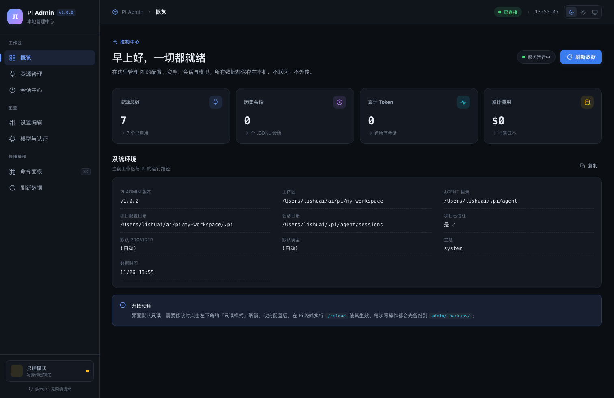
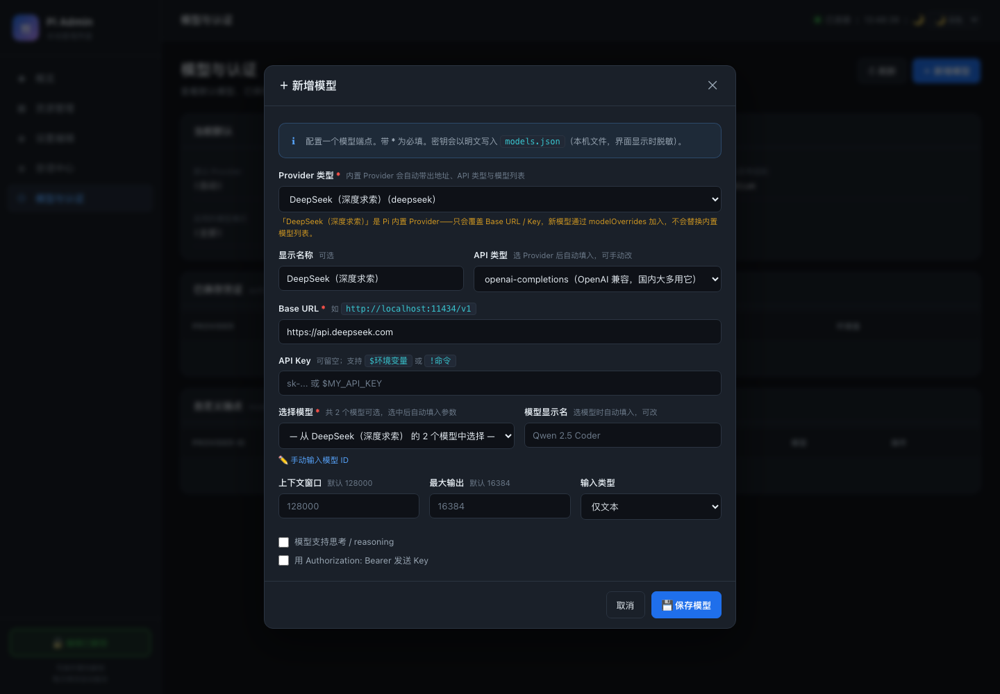
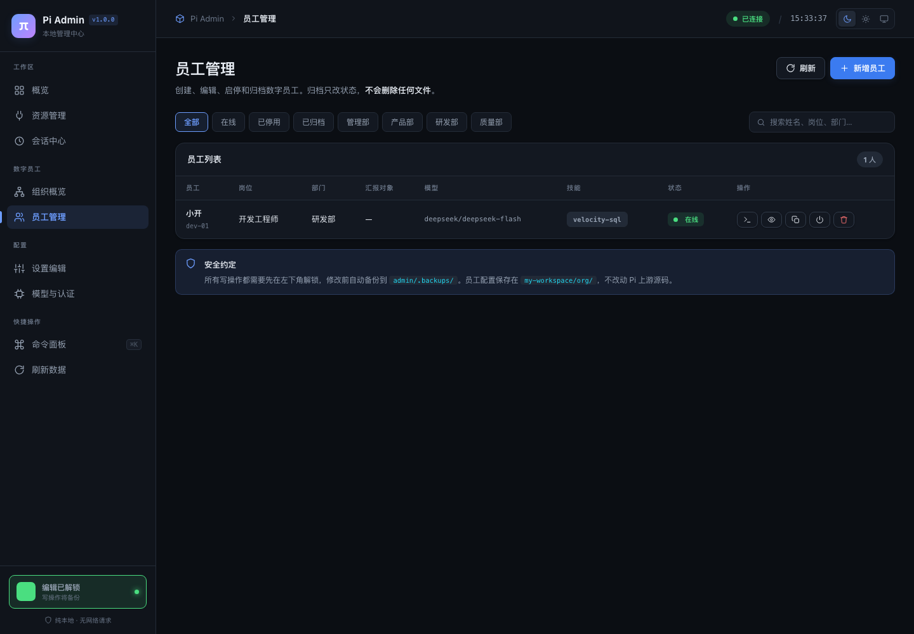

# Pi Admin — Pi 本地 Web 管理界面

一个**纯本地、零新增依赖**的 Web 管理界面，用来管理 Pi 的配置、资源、会话、模型，以及本地数字员工团队。它直接读写 Pi 的真实配置文件（不用改 Pi 源码），只绑定 `127.0.0.1`，不联网、不外传数据。

## 启动

```bash
cd /Users/lishuai/ai/pi/my-workspace/admin
bash start.sh              # 默认 8787 端口
bash start.sh 9000         # 指定端口
```

然后浏览器打开 **http://127.0.0.1:8787**

停止：在终端按 `Ctrl+C`。

> 如果点击「新增员工 / 新增部门」提示「管理服务还是旧版本」或「未知 API」，说明当前服务是在 P1 升级前启动的旧进程。按 `Ctrl+C` 停止后重新执行 `bash start.sh` 即可。

### 界面预览

| 概览 | 资源管理 | 模型与认证 |
|---|---|---|
|  |  |  |

| 组织概览 | 员工管理 | 浅色主题 |
|---|---|---|
|  |  |  |

设计特性：统一线性 SVG 图标（无 emoji）、分组侧栏导航、面包屑、统计卡、带插画的空状态、加载骨架屏、表格搜索、命令面板、深浅主题。

### 高效操作

| 操作 | 方式 |
|---|---|
| **命令面板** | `⌘K` / `Ctrl+K`，或直接点侧栏「命令面板」——搜索页面与操作、键盘 ↑↓ 选择、回车执行 |
| 键盘关闭 | `Esc` 关闭命令面板或弹窗 |
| 搜索过滤 | 资源页、会话页右上角搜索框，实时过滤 |
| 深链直达 | `http://127.0.0.1:8787/#resources` 进入指定页面（支持 `overview/resources/org/employees/settings/sessions/models`） |
| 指定主题 | `?theme=light` 临时指定，如 `?theme=light#models` |
| 直达新增模型 | `#addmodel` 打开弹窗（需先解锁）；`#addmodel:deepseek` 直达某 Provider（如 `#addmodel:kimi-coding`） |
| 直达新增员工 | `#addemployee` 打开员工创建弹窗（需先解锁） |
| 打开命令面板 | `#command` 深链 |


## 界面主题

顶栏右上角的三段式切换器（月亮 / 太阳 / 显示器图标）：

| 主题 | 说明 |
|---|---|
| 深色 | 默认，护眼 |
| 浅色 | 明亮环境或截图用 |
| 自动 | 跟随系统 `prefers-color-scheme` |

偏好存在浏览器 `localStorage`（键 `pi-admin-theme`），刷新后保持。切换即时生效，无需重启服务。


## 六个模块

| 模块 | 能做什么 |
|---|---|
| **概览** | 资源/会话/token/费用统计，路径与环境信息，项目信任状态 |
| **组织概览** | 数字员工的组织架构图、部门与岗位模板统计，点击架构图卡片直接编辑 |
| **员工管理** | 创建/编辑/克隆/启停/归档数字员工，配置岗位、模型、技能、权限与预算 |
| **资源管理** | 列表展示 extensions / skills / prompts / themes，开关启停（等价 `pi config` 的网页版） |
| **设置编辑** | 图形化查看/编辑 settings / mcp / models / keybindings 四份 JSON，带路径显示 |
| **会话中心** | 会话列表、按角色查看对话时间线、token/费用统计、**新开会话**、导出 JSONL、删除会话 |
| **模型与认证** | 默认模型、已存凭证、自定义端点；**密钥一律脱敏**（首尾各 4 位，中间打码）；**可新增/删除模型** |

### 新开会话

在「会话中心」点右上角 **＋ 新开会话**（先解锁编辑），填写工作目录（默认当前工作区）、可选名称和第一句话，点「创建会话」：

- 生成 Pi v3 格式的 JSONL 会话文件，存到 `~/.pi/agent/sessions/` 对应目录，列表立刻可见。
- 弹窗给出一条 **`pi --session <id>`** 命令，点「复制」后在终端粘贴即可继续这条会话，首句话会作为第一条用户消息。
- 工作目录会跟随符号链接解析到真实路径，与 Pi 自己的定位一致，避免打开时误判为“不同项目”要 fork。
- 这里只创建会话文件、**不启动模型**；真正对话仍在 Pi 终端里进行。密钥和操作全程受只读锁保护。


### 新增模型（重点）

在「模型与认证」页点右上角 **＋ 新增模型**（先解锁编辑）。现在支持从 Pi 内置目录**按 Provider 选择**，覆盖国内外共 41 家、1600+ 模型：

**联动流程**（不用手写 ID）：

1. **Provider 类型**下拉按「🇨🇳 国内 / 🌍 国外」分组——国内含 DeepSeek、Kimi、通义千问、智谱 GLM、MiniMax、蚂蚁灵犀、小米等；国外含 OpenAI、Claude、Gemini、Grok、OpenRouter 等。
2. 选中后自动带出 **Base URL、API 类型、显示名称**，并把该 Provider 的模型填进「选择模型」下拉，选项格式为 **`模型名称 — 模型ID`**（如 `DeepSeek V4.1 Flash — deepseek-flash`）。
3. 选中模型后自动填入 **模型 ID、显示名、上下文窗口、最大输出、输入类型、reasoning**——你只需填 API Key。
4. 要接自建/代理端点：选「✏️ 自定义 Provider」，手动填 ID 和模型 ID；点「✏️ 手动输入模型 ID」可在两种模式间切换。



| 字段 | 说明 |
|---|---|
| Provider 类型 | 分组下拉；内置 ID 只覆盖 Base URL / Key，新模型走 `modelOverrides`，不会替换内置模型列表 |
| Base URL | 选内置 Provider 自动填入；自定义必填，如 `http://localhost:11434/v1` |
| API 类型 | 选 Provider 自动填入，可手动改；国内模型大多是 `openai-completions` |
| API Key | 可留空；支持 `$环境变量`、`!命令` 动态取值 |
| 选择模型 / 模型 ID | 下拉选内置模型（名称+ID），或手动输入自定义模型 ID |
| 模型显示名 | 选模型时自动填入，可改 |
| 上下文窗口 / 最大输出 | 选模型时自动填入，也可手动改；默认 128000 / 16384 |
| 输入类型 / reasoning / Bearer | 选模型时自动填入部分，可手动改 |

保存后写入 `~/.pi/agent/models.json`，Pi 里打开 `/model` 会自动重新加载（或执行 `/reload`）。自定义端点表格里每个模型右侧的 `✕` 可删除模型。

**与数字员工联动**：新增模型会立即出现在「新建员工」的 Provider → 模型下拉里（选项格式 `模型名称 — 模型ID`，带自定义标记），无需重启或刷新；删除模型后也会同步移除。内置 Provider 下新增的模型归到该 Provider，自建端点的模型归到「自定义 Provider」分组。

常见场景：
- **国内大模型**：Provider 选 DeepSeek / Kimi / 通义千问 / 智谱 GLM 等 → 模型下拉选具体型号 → 只填 API Key → 保存。
- **Ollama 本地模型**：选「自定义 Provider」，ID 填 `ollama`，Base URL `http://localhost:11434/v1`，API `openai-completions`，Key 随便填（如 `ollama`，Ollama 忽略），模型 ID 填你的模型名。
- **OpenAI 兼容代理**：选「自定义 Provider」+ 代理地址 + `openai-completions` + 真实 Key。
- **走代理用内置模型**：Provider ID 填 `openai` 等内置 ID，只改 Base URL，模型列表保持不变。


## 数字员工（P1 已实现）

组织与员工配置保存在工作区的 `my-workspace/org/`，不修改 Pi 上游源码：

```
org/
├── departments.json        # 部门列表
├── roles.json              # 自定义岗位（可选，未创建时用内置模板）
├── employees/<id>.json     # 每个员工一份配置
└── workspaces/<id>/.pi/SYSTEM.md  # 员工人格提示词（对话时自动生成，写前备份）
```

- **内置岗位模板**：主管、产品经理、架构师、开发工程师、测试工程师、运维工程师、数据分析师、协调员。选岗位会自动带出部门、权限、提示词和部分技能。
- **组织架构图**：按“你 → 主管 → 部门 → 员工”绘制，状态用颜色区分；点员工卡片直接编辑。
- **员工配置**：姓名、ID、岗位、部门、汇报对象、Provider/模型、技能、文件/命令/网络权限、Token 与费用上限、系统提示词。
- **启停与归档**：启停只切换 `active / idle`；归档为 `archived`，**配置文件保留并先备份，不做删除**。
- **部门管理**：在组织概览新增部门；部门列表每项右侧有编辑和删除按钮。编辑时 ID 锁定、可改名称与描述；删除需先解锁，且部门下仍有在职员工时会被拒绝（需先迁移员工，归档员工不阻塞），保存/删除前自动备份 `departments.json`。
- **与员工对话**：员工管理表格的「终端」图标按钮 → 填第一句话 → 创建会话，得到一条 `pi --session ... --model ... --system-prompt ...` 命令，复制到终端即可按该员工的身份、模型和权限对话。同时会在 `org/workspaces/<id>/.pi/SYSTEM.md` 写入人格提示词（覆盖前自动备份）；会话出现在会话中心。首次进入该目录若提示信任项目，选择信任即可。
- **API**：`/api/org/overview`、`/api/org/employees`、`/api/org/employees/:id`、`/api/org/employees/:id/toggle`、`/api/org/employees/:id/archive`、`/api/org/employees/:id/chat`、`/api/org/departments`、`/api/org/roles`。




## 安全设计

- **默认只读**：所有写操作（启停资源、保存 JSON、删除会话、新增/删除模型）都需要先在左下角点「解锁编辑」。解锁只是当前会话的内存态，刷新页面即失效。
- **路径白名单**：只能访问 `~/.pi/agent/` 和当前工作区，禁止目录穿越。
- **绝不泄露密钥**：`auth.json` / `models.json` 里的 key、access、refresh token 返回前全部脱敏，界面看不到明文。
- **写前自动备份**：每次写文件前，原文件复制到 `admin/.backups/<时间戳>/`，出问题可回滚。
- **本地绑定**：服务只监听 `127.0.0.1`，局域网访问不到。

## 配置项

`server.mjs` 支持三个参数：

```bash
node server.mjs --port 8787 \
  --workspace /path/to/project \
  --agent-dir /path/to/agent-dir
```

- `--workspace`：项目目录，默认 `admin/` 的上两级（即 `my-workspace/`），项目级配置读它的 `.pi/`。
- `--agent-dir`：用户级配置目录，默认 `~/.pi/agent`（或环境变量 `PI_CODING_AGENT_DIR`）。
- `--port`：端口，默认 8787。

## 目录结构

```
admin/
├── server.mjs          # 后端：Node 原生 http，零依赖
├── start.sh            # 启动脚本
├── README.md
├── .backups/           # 写操作自动备份（自动创建）
└── public/
    ├── index.html      # 界面结构
    ├── style.css       # 样式
    └── app.js          # 交互逻辑
```

## 与 Pi 的配合

改完配置后，在 Pi 终端里执行 `/reload` 让改动生效。资源管理页的开关写入的是 `settings.json` 里的 `+pattern` / `-pattern`，与 `pi config` 完全一致的格式。

## 扩展规划

「数字员工」模块的完整产品与技术规划见 [`../docs/04-数字员工功能规划.md`](../docs/04-数字员工功能规划.md)。P1 的组织管理、架构图与员工配置已实现；员工之间的沟通中心、任务看板（P2）和真实执行引擎（P3）仍在规划中。

## 说明

这是二开工作台的一部分，不是 Pi 官方功能。它是独立的外部工具，通过读写配置文件工作，Pi 本体没有任何改动。
